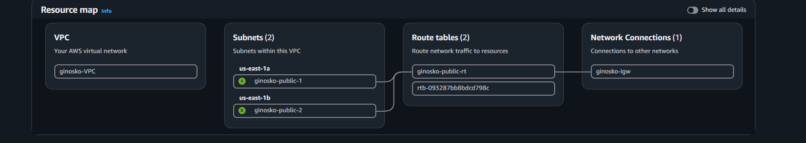
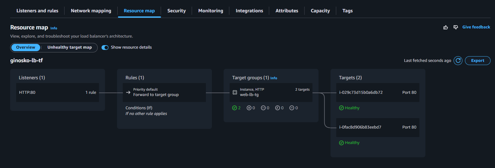
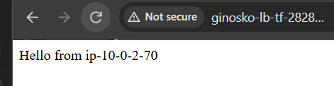
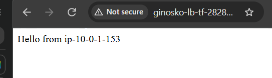

# Simple Web Infrastructure on AWS with Terraform

A load-balanced web server setup on AWS, built with Terraform. An Application
Load Balancer distributes HTTP traffic across two Ubuntu servers running nginx,
placed in separate availability zones inside a custom VPC.

## Architecture

- **VPC** with DNS support enabled
- **2 public subnets** in different availability zones (`us-east-1a`, `us-east-1b`)
- **Internet gateway** and a public route table
- **Application Load Balancer** listening on port 80
- **Target group** with health checks, forwarding to the servers
- **2 EC2 instances** (Ubuntu 24.04, `t3.micro`) running nginx, installed through `user_data`
- **Security groups** that only allow web server traffic from the load balancer



## Prerequisites

- Terraform = 1.16.6
- An AWS account with credentials configured (`aws configure`)

## Usage

```bash
terraform init
terraform plan
terraform apply
```

After apply, open the `lb_address` output in your browser (`http://...`).
Refresh a few times: the hostname changes as the load balancer alternates
between servers.

## Result



Refreshing the page alternates between the two servers;




## Cleanup

```bash
terraform destroy
```

The load balancer and instances are billed hourly, so destroy the stack when
you're finished.

## Design decisions

- Public subnets are simple and cheap and was used since this was for test/learning purposes. Although for a production style setup, You need to avoid servers being accessed directly from the internet by implementing NAT service.

- Ingresss rule on the web-tier referenced another security group (ALB) instead of a CIDR range.

## What I learned

- Terraform runs the Infra code in its correct order as every block or module references its dependencies
- Resources create things, while data sources look things up.
- `terraform validate` catches syntax and reference errors, but it can't catch typos in free-form values. - A mispelled tag key (`Nmae`) and a bad command in my `user_data` script (`apt_get`) both passed validation
 A `.gitignore` has to exist before the first commit. It keeps `.terraform/`
  (over 100 MB) and state files (which describe real infrastructure) out of the
  repo, while `.terraform.lock.hcl` is committed to pin provider versions.
- A `.tfvars.example` documents the configurable values without exposing real
  ones.
- Deletion protection on a load balancer blocks `terraform destroy`, and
  load balancers and instances are billed hourly, so I destroy the stack when
  I'm done.